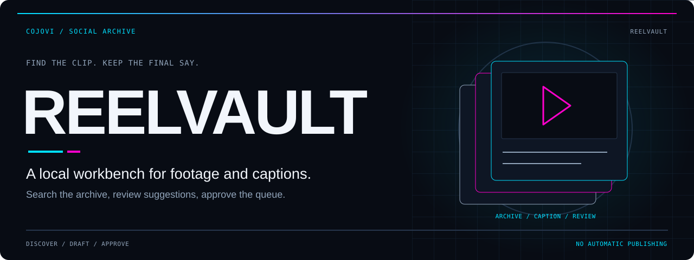
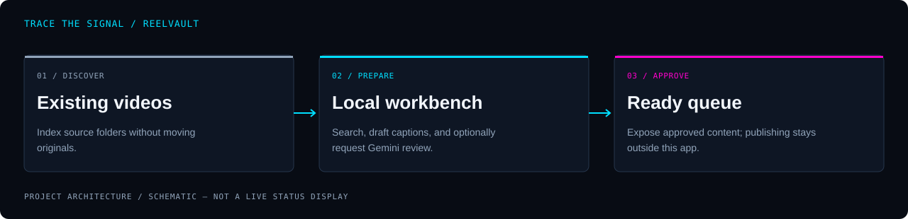

<!-- COJOVI / SIGNAL — ReelVault project edition. Commit with readme-assets/. -->
<a name="top"></a>

<p align="center">
  
</p>

<h1 align="center">ReelVault</h1>

<p align="center">
  <strong>Find the clip. Shape the story. Keep the final say.</strong><br>
  A local video archive and caption workbench, with optional Gemini assistance and an approved-content queue.
</p>

<p align="center">
  
</p>

<p align="center">
  <a href="#overview">Overview</a> ·
  <a href="#architecture">Architecture</a> ·
  <a href="#quickstart">Quickstart</a> ·
  <a href="#configuration">Configuration</a> ·
  <a href="#usage">Workflow</a> ·
  <a href="#security">Security</a>
</p>

---

<a name="overview"></a>
## `> meet_reelvault`

**ReelVault is the application in `cojo_social_media_dashboard`.** It indexes existing video folders without moving originals, keeps editorial work in SQLite, and gives the same catalog to a React dashboard and a Python CLI.

Browse by subject, filename, folder, storage state, captions, or notes. Review suggestions separately from the text you approve.

| Discover | Prepare | Approve |
| :--- | :--- | :--- |
| Recursively catalog video files and track local, offloaded, or missing sources. | Add notes and captions; optionally request visual labels or a full Gemini review. | Expose only ready, approved records with a nonblank caption and a source not marked missing. |

> [!IMPORTANT]
> **This prepares content; it does not publish it.** There are no social-platform login, scheduling, or posting integrations. The ready queue is a handoff surface, not proof that a post was delivered.

<a name="architecture"></a>
## `> trace_the_signal`

<p align="center">
  
</p>

```text
Existing video folders
        ↓ metadata discovery
FastAPI + SQLite ←→ React workbench / Typer CLI
        ├─ cached thumbnails + persistent quick-description jobs
        ├─ optional stills or full-video upload → Gemini
        └─ human approval → ready queue / JSON or CSV export
```

The CLI imports the backend directly; it does not call the HTTP API. The backend owns periodic scans and the durable quick-description worker. Full-review selections are processed by the browser queue, so keep that tab open until the batch finishes.

### Two distinct AI paths

| Mode | Evidence sent | Result |
| :--- | :--- | :--- |
| Quick description | Up to three small local frames, or one cached thumbnail; no audio | Rough summary, category, searchable tags |
| Full video review | Original video uploaded through Gemini Files API, including audio | Summary, suggested caption, hashtags, platform suggestion, review notes |

Quick descriptions do not overwrite manual captions or approval. The full-review prompt defaults toward home-services marketing unless the clip suggests another subject. Review its output for your actual audience.

<a name="quickstart"></a>
## `> open_the_archive`

**Prerequisites:** Git, Python 3.10+, Node.js 22.13+ within the 22.x line or Node.js 24+, npm, and FFmpeg for local frame extraction. The backend worker uses POSIX file locking: macOS/Linux are the setup path here; native Windows is not established. Finder, Quick Look, and iCloud-specific behavior require macOS.

### 1. Prepare a fresh checkout

```bash
git clone https://github.com/cojovi/cojo_social_media_dashboard.git
cd cojo_social_media_dashboard
python3 -m venv .venv
source .venv/bin/activate
python -m pip install -r backend/requirements.txt
npm ci --prefix frontend
# Create only if absent; preserve existing local configuration.
test -e backend/.env || cp .env.example backend/.env
```

### 2. Configure before starting

Edit **`backend/.env`**. Set `REELS_FOLDER`, `DATABASE_PATH`, and `THUMBNAILS_FOLDER` to your own **absolute paths**, keeping the database and thumbnail cache outside the checkout. The video directory must already exist. For a first local-only session, leave `GEMINI_API_KEY` blank, ensure it is not exported in your shell, and set `AUTO_QUICK_SUMMARY=false`.

> [!NOTE]
> **The current settings loader resolves its root to `backend/`, not the repository root.** Direct backend and CLI commands read `backend/.env`, and relative storage paths resolve under `backend/`. The separate [start.sh](start.sh) launcher exports a root `.env` instead. Use the direct commands below consistently so the UI and CLI share one configuration. See [settings.py](backend/app/settings.py).

### 3. Start the two development servers

In the activated Python environment, from the repository root:

```bash
PYTHONPATH=backend python -m uvicorn app.main:app --host 127.0.0.1 --port 8000
```

In a second terminal, from the same repository root:

```bash
npm run dev --prefix frontend -- --host 127.0.0.1 --port 5173 --strictPort
```

Open **[http://127.0.0.1:5173](http://127.0.0.1:5173)**. API documentation is at **[http://127.0.0.1:8000/docs](http://127.0.0.1:8000/docs)**. Without a Gemini key, scanning, browsing, editing, and approvals remain available.

Keep both servers on loopback. These are development servers, not a public deployment recipe.

<a name="configuration"></a>
## `> tune_the_archive`

The [.env.example](.env.example) lists configuration keys; the [settings loader](backend/app/settings.py) defines defaults. Restart the backend after changing environment settings.

| Setting | Purpose / default |
| :--- | :--- |
| `REELS_FOLDER` | Existing source tree; choose an explicit absolute path. |
| `DATABASE_PATH` | SQLite catalog; relative default `./data/reelvault.db` under `backend/`. |
| `THUMBNAILS_FOLDER` | Cached previews; relative default `./data/thumbnails` under `backend/`. |
| `GEMINI_API_KEY` | Optional cloud-analysis credential; blank disables AI requests. |
| `GEMINI_MODEL` | Full-review model; default `gemini-2.5-flash`. |
| `QUICK_SUMMARY_MODEL` | Visual-label model; default `gemini-2.5-flash-lite`. |
| `AUTO_SCAN` | Startup/periodic discovery; default `true`. |
| `SCAN_INTERVAL_SECONDS` | Default `900`, minimum `30`. |
| `AUTO_QUICK_SUMMARY` | Enqueue undescribed items after scans; default `true`. |
| `FILE_SETTLE_SECONDS` | Wait for stable new files; default `60`. |

`QUICK_SUMMARY_DELAY_SECONDS` defaults to `4`; `QUICK_SUMMARY_DAILY_BUDGET_USD` defaults to `1`. The budget is an **application estimate limit for quick descriptions**, not a provider billing cap, and excludes full reviews. Model identifiers are source defaults, not guarantees of provider availability.

`APP_HOST`, `APP_PORT`, and `FRONTEND_PORT` are also read by settings. The direct commands above explicitly choose the listening ports; [Vite's proxy](frontend/vite.config.ts) is fixed to backend port `8000`. Changing environment port values alone does not update the frontend proxy or Vite's configured port.

<a name="usage"></a>
## `> curate_the_queue`

1. Add supported videos beneath the configured source folder: MP4, MOV, M4V, AVI, WEBM, or MKV.
2. Let startup/periodic scanning discover them, or use **Rescan Folder**. Empty files and recent writes wait for a later scan.
3. Search and filter the catalog. Open playback intentionally; editing and hovering do not preload originals.
4. Optionally enable quick descriptions or request a full review. Offloaded files without a cached preview wait for local media.
5. Write a final caption, approve it, then mark it ready. Approval and status are separate controls.
6. Read or export the ready queue for a separate, explicitly authorized posting workflow.

Run CLI commands from the repository root with the same Python environment and `backend/.env`:

```bash
python cli/reelctl.py list
python cli/reelctl.py archive-status
python cli/reelctl.py next-ready
python cli/reelctl.py export-ready --format json
```

Additional commands include `scan`, `show`, `set-post`, `set-hashtags`, `approve`, `status`, `analyze`, `describe-missing`, and `pause-descriptions`. `analyze` can upload a video and incur provider charges; `describe-missing` queues backend work. Review command help before changing records.

API equivalents include `/api/reels`, `/api/archive`, and `/api/queue/ready`. Queue eligibility excludes records marked missing, but does not guarantee an offloaded original is immediately downloadable.

<a name="storage"></a>
## `> preserve_the_work`

- SQLite stores editorial fields, descriptions, jobs, and recorded AI usage; thumbnails live separately.
- Scans do not move or delete originals, request bulk cloud downloads, or evict files. Explicit playback can trigger a provider download.
- Missing files retain their catalog history. Identity is based on absolute path: moving or renaming originals creates new records rather than relinking old ones.
- Changed source content clears cached quick-description/thumbnail references; manual text and historical full analysis remain.
- Populated databases receive backups before supported additive migrations. Backups are written beside the database in `backups/`.

Use SQLite's backup API for a live database. Do not copy only the `.db` file while WAL writes are active. Stop all backend/CLI writers before restoring, retain the current database and its WAL/SHM files, and restore the chosen backup to `DATABASE_PATH`. Database backups do not include source videos.

<a name="validation"></a>
## `> check_the_work`

The repository provides these development checks:

```bash
PYTHONPATH=backend python -m pytest backend/tests -q
npm run build --prefix frontend
npm run lint --prefix frontend
```

**Builds, tests, application startup, and provider calls were not run for this docs-only task.** Source inspection is not runtime certification.

Before using a real archive, confirm the configured directories, shared CLI/UI database, loopback binding, queue rules, backup strategy, and cloud-upload consent using a small non-sensitive fixture set.

<a name="source"></a>
## `> explore_the_source`

| Source | Responsibility |
| :--- | :--- |
| [API entrypoint](backend/app/main.py) | FastAPI routes, thumbnails, worker lifecycle |
| [Scanner](backend/app/scanner.py) / [worker](backend/app/archive.py) | Discovery, persistent jobs, retries and pause state |
| [Models](backend/app/models.py) / [database](backend/app/database.py) | Editorial validation, queue predicates, SQLite migrations |
| [Dashboard](frontend/src/App.tsx) / [archive panel](frontend/src/ArchivePanel.tsx) | Browsing, editing, automation visibility |
| [CLI](cli/reelctl.py) | Local catalog operations and export |
| [Archive design](ARCHIVE_DESIGN.md) | Design rationale and historical measurements, not current test results |

<a name="security"></a>
## `> draw_the_boundary`

**Single-user, trusted local use only.** There is no multi-user authentication. CORS is not access control; do not expose the API, thumbnails, or development UI to untrusted networks.

AI is optional but not on-device: selected stills or videos leave the machine. Full-review upload cleanup is attempted, not guaranteed. Protect configuration, database backups, logs, and media; clear sensitive content from bug reports. Keep real keys out of Git.

No repository license file was found in this revision. Public source visibility does not grant a permissive reuse license; obtain permission before redistribution or use that requires one.

---

<p align="center">
  
</p>

<p align="center">
  <strong>Originals stay put. Editorial control stays yours.</strong><br>
  <sub>A <a href="https://github.com/cojovi">Cody / cojovi</a> project · <a href="https://cojovi.com">cojovi.com</a><br>
  ReelVault, presented in COJOVI / SIGNAL.</sub>
</p>

<p align="center"><a href="#top">↑ Back to the signal</a></p>
